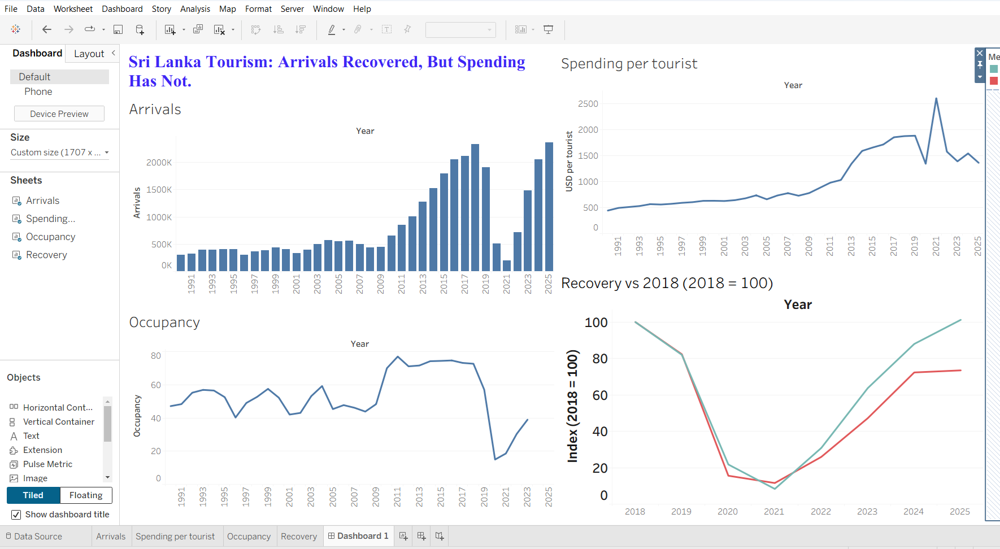
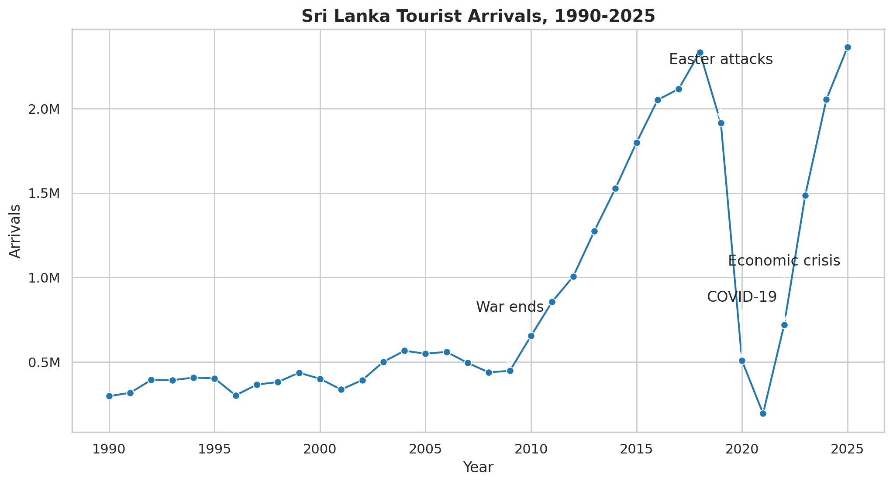
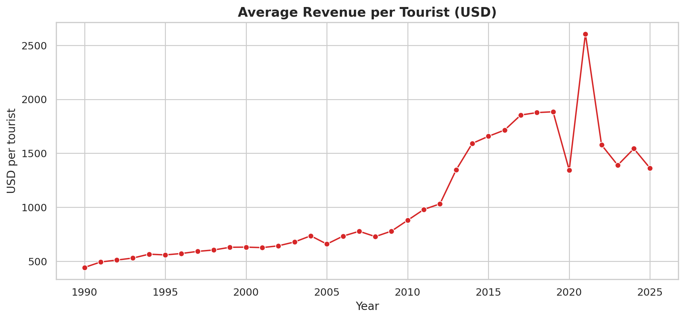
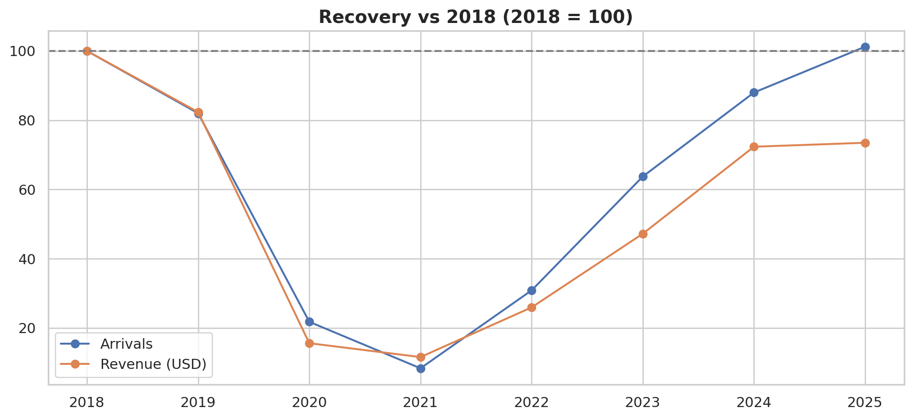
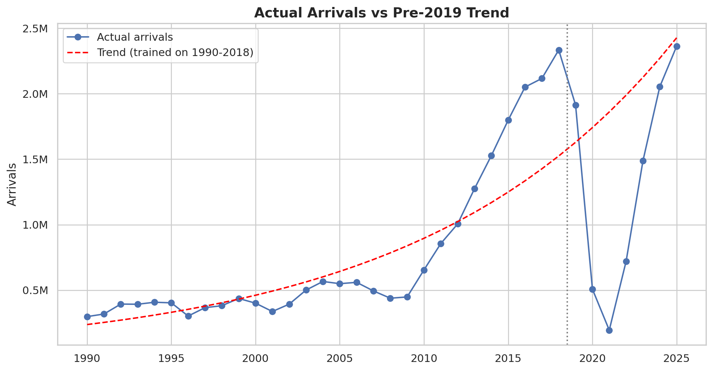

# Sri Lanka Tourism Analysis (1990-2025)

## Question
Has Sri Lanka tourism really recovered after COVID-19 and the 2022 crisis?

## Data
Advocata Institute tourism data: tourist arrivals, hotel occupancy and
tourism revenue, 1990-2025. Revenue figures are estimates.

## Tools
Python (Pandas, Matplotlib, Seaborn, scikit-learn), Google Colab, Tableau Public

## Dashboard
[Live dashboard on Tableau Public](https://public.tableau.com/app/profile/nimna.wijerathne/viz/SriLankaTourismAnalysis/Dashboard1)

## Key findings
- Arrivals reached about 2.36 million in 2025, back to the 2018 level (about 101%).
- Revenue in 2025 is only about 73% of 2018.
- Revenue per tourist fell from about $1,877 (2018) to about $1,363 (2025).
- Hotel occupancy fell from 72.8% (2018) to 15% (2020).

## Charts

## Machine learning and statistics
- **Anomaly detection:** the z-score flagged only 2022; Isolation Forest flagged 2020-2023.
- **Forecasting:** a log-linear trend trained on 1990-2018 shows about 6.9% yearly growth. It missed the 2020-2022 shocks (MAE about 767,000 arrivals), but by 2025 arrivals were back to about 97% of the old trend.
- **Revenue regression:** arrivals and occupancy predict revenue with test R² of about 0.89 (MAE about $290 million), but the test set is small and revenue is an estimate.

## Recommendation
Focus on increasing spending per tourist (longer stays, higher-value tourism),
not only on increasing arrivals.

## Limits
Only 36 yearly data points; revenue is an estimate; occupancy is missing for
2024-2025; ML models on this little data are only indicative.

## Files
- `Tourism.ipynb`: full analysis notebook
- `tourism-data.csv`: original data
- `tourism_clean.csv`: cleaned data used for Tableau
